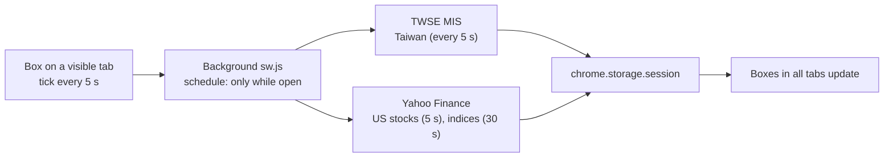
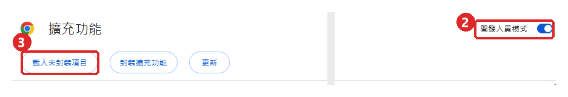

# 📈 PeekaStock

**A hideable stock ticker for Taiwan and US markets: a small floating box in the corner of any web page, one shortcut away from vanishing.**

**Draggable, resizable floating box**, **boss key**, **stealth look**, **price & big-move alerts**, **watchlist with custom tabs**, and a UI in six languages. Quotes only — no trading.

[](manifest.json)
[](#-install)
[](#-privacy)
[](LICENSE)
[](#-ui-languages)

[繁體中文](README.md) · **English** · [日本語](README.ja.md) · [简体中文](README.zh-Hans.md) · [한국어](README.ko.md) · [Español](README.es.md)

[Why](#-why) · [Features](#-features) · [Data sources and delay](#-data-sources-and-delay) · [Install](#-install) · [Usage](#-usage) · [Permissions](#-permissions) · [Known limitations](#-known-limitations) · [Privacy](#-privacy) · [Development](#-development)

---

## 💡 Why

I wanted to glance at the market during work, but a trading app is too conspicuous and free web quotes are often 15–20 minutes late. So I made a small box that floats in the corner of whatever page I'm reading — and disappears with one shortcut when someone walks by.

> [!NOTE]
> **No account, no API key, no server, no fees.** Quotes come straight from the public web endpoints of the Taiwan Stock Exchange and Yahoo Finance, without any third-party server in between.

## ✨ Features

- **On every page**: the box appears in the corner of every tab, and all tabs share the same position and size. Drag it, resize it from any corner; it stays visible in full-screen video.
- **Boss key**: press **Alt+Shift+H** (or click the PeekaStock toolbar icon) to hide the box in all tabs at once. While hidden, nothing is fetched.
- **Stealth look ◐**: transparent background, gray text, ▲▼ instead of colors — it looks like part of the page.
- **Mini peek ▁**: the box shrinks to cat ears and one line, showing the next quote every 4 s.
- **Alerts**: when a quote moves more than ±3% (adjustable) or hits your target price, a paw bubble pops up in the box (e.g. "NVDA up ▲3.2%!"); in stealth look only the row is highlighted. No system notifications.
- **Watchlist**: type `2330` or `AAPL` to add; listed (TWSE) / OTC (TPEx) / US is detected automatically. US stocks show tickers, Taiwan stocks show names.
- **Tabs**: `All | Taiwan | US | World`, plus your own tabs (e.g. "Tech", "Dividend"). A stock can be in several tabs.
- **World indices**: 16 indices from Taiwan, US, China, Hong Kong, Japan, Korea, Singapore, UK, France and Germany, each can be turned on or off.
- **Up/down colors**: red up, green down (Taiwan convention) or green up, red down (US convention).
- **UI languages**: 繁中 / English / 日本語 / 简中 / 한국어 / Español, following Chrome's language by default.

## ⏱️ Data sources and delay

| Item | Source | Measured delay (Oct 2026) |
|---|---|---|
| Taiwan stocks, TAIEX, TPEx Index | TWSE "Market Information System" (MIS) | a few seconds to 2 minutes |
| US stocks, Dow Jones, S&P 500, Nasdaq, PHLX Semiconductor | Yahoo Finance | a few seconds |
| Shanghai, Shenzhen, CSI 300, Hang Seng, Nikkei, STI, FTSE, CAC, DAX | Yahoo Finance | about 15 minutes |
| KOSPI | Yahoo Finance | about 20 minutes |

- Every row shows its **data time**; intraday rows older than 2 minutes turn gray, so you can see what is stale.
- Taiwan stocks often have no trade price during the session; PeekaStock then shows the best bid (or ask) and marks it "Bid"/"Ask".
- Closed markets are not fetched. If no tab is in the foreground, or the box is hidden, no requests are sent at all.



## 🚀 Install

PeekaStock is not on the Chrome Web Store yet. Install it with "Load unpacked":

### 1. Download

Click **[⬇ Download ZIP](https://github.com/Ashur5457/PeekaStock/archive/refs/heads/main.zip)** and unzip it (you get a `PeekaStock-main` folder). With git: `git clone https://github.com/Ashur5457/PeekaStock.git`

### 2. Turn on developer mode

Open `chrome://extensions` and turn on **Developer mode** (top right)



### 3. Load

Click **Load unpacked** and choose the `PeekaStock-main` folder (the one that directly contains `manifest.json`)

### 4. Pin the icon

Click the puzzle button 🧩 in the toolbar and pin PeekaStock (clicking the icon hides/shows the box)

### 5. Reload your pages

**Reload** the pages you already have open; the box appears in the bottom-right corner

## 🎬 Usage

1. Hover over the box to show the toolbar: **⚙** settings, **▁** mini peek, **◐** stealth look, **👁** hide, **↺** reset position. Drag the toolbar (cat head) to move the box.
2. **⚙ Settings**:
   - **Watchlist**: enter a code and click Add; ↑↓ to reorder, ✕ to remove
   - **Custom tabs**: add, ✎ rename, ↑↓, ✕; tick what goes into a tab under "Add to tab"
   - **Indices**: turn each on or off
   - **Alerts**: big moves ±% (default 3%); for a price alert tap 🔔 on a watchlist row and set an upper/lower price; with "Background" on, alerted items are also checked once a minute while the box is out of sight (market hours only), and the alert pops up the next time you see the box
   - **Display**: UI language, up/down colors
3. **Boss key Alt+Shift+H**: hides the box in all tabs; press again to bring it back. Clicking the PeekaStock toolbar icon does the same.

> [!TIP]
> If Alt+Shift+H does nothing, another extension may be using it. Set a different shortcut at `chrome://extensions/shortcuts`.

## 🔐 Permissions

Chrome warns that PeekaStock can "read and change all your data on all websites". That is because the box has to be drawn on **every page**, so its script must be injected into every page.

- The box only draws quotes. It **does not read or collect page content**.
- It connects to exactly two sites: `mis.twse.com.tw` (Taiwan Stock Exchange) and `query1.finance.yahoo.com` (Yahoo Finance).
- It also uses the `alarms` permission, only when you turn on background alerts: it wakes the background script once a minute.

## ⚠️ Known limitations

- **Both data sources are unofficial endpoints**: if TWSE or Yahoo change their format, quotes may stop; the box shows an error at the bottom.
- **Public holidays are not handled**: on a holiday you see the previous session's close.
- **US prices** are Nasdaq real-time prices from a single exchange, which can differ slightly from the consolidated price your broker shows.
- **Non-US indices** are delayed 15–20 minutes on Yahoo itself.
- **Pages where the box cannot appear**: `chrome://` pages, the New Tab page, the Chrome Web Store, and the built-in PDF viewer.
- Up to 100 watchlist stocks and 10 custom tabs.
- UI and README translations other than Traditional Chinese are AI-generated; corrections from native speakers are welcome.

## 🔒 Privacy

- **No data is collected** — no analytics, tracking or ads.
- Only stock codes (e.g. `2330`, `AAPL`) are sent to TWSE and Yahoo, just as when you open their pages yourself.
- Settings (watchlist, tabs, position, language) are stored in Chrome's local storage (`chrome.storage.local`); quotes are kept only in memory (`chrome.storage.session`) and cleared when the browser closes.

## 📜 Disclaimer

PeekaStock only displays quotes and **is not investment advice**. Quotes may be delayed, wrong or unavailable; rely on your broker or the exchange. This project is not affiliated with the Taiwan Stock Exchange or Yahoo.

## 📂 Files

```
PeekaStock/
├── manifest.json         # Extension manifest (MV3)
├── sw.js                 # Background: scheduling, fetching, boss key, code lookup
├── sources.js            # Data sources: TWSE MIS, Yahoo spark (parsing and error codes)
├── schedule.js           # What to fetch this tick (market open, interval, back-off)
├── markets.js            # Market table (time zones, sessions), index table
├── prefs.js              # Settings; watchlist and tab operations
├── overlay.js            # Floating box (Shadow DOM): drag, resize, tab bar, quote table
├── panel.js              # ⚙ settings panel
├── alerts.js             # Alert rules: price targets, big moves, once a day
├── box.js                # Box position and size math
├── i18n.js               # UI strings (one line per string, six languages side by side)
├── _locales/             # Extension description and shortcut text in six languages
├── icons/                # Extension icons
├── tools/test.mjs        # Tests: node tools/test.mjs
├── tools/probe.mjs       # Data source probe: node tools/probe.mjs
├── tools/make_icons.ps1  # Icon generator (PowerShell)
└── CLAUDE.md             # Developer notes (Traditional Chinese): requirements, architecture, measurements, pitfalls
```

## 🛠️ Development

No build step and no packages: after editing, click 🔄 on `chrome://extensions`, then **reload the page**.

- Tests: `node tools/test.mjs` (Node.js 18+). Runs the full flow with real-format responses and checks for missing translations.
- Data source probe: `node tools/probe.mjs` prints the delay of every code and whether each endpoint can fetch many codes at once.

Read [`CLAUDE.md`](CLAUDE.md) first (Traditional Chinese) — it has the measurements and **pitfalls**. A few rules:

1. **Must stay free**: no paid APIs, no API keys for users, no servers, no data collection.
2. **All UI text goes into `i18n.js`**: a test fails if code contains untranslated Chinese.
3. **Buttons in the quote area use `pointerdown`**: quotes re-render every few seconds, so `click` is unreliable.
4. **Scope shared styles by element type**: the settings panel and the box share one Shadow DOM.
5. **Add a timestamp to request URLs**: Yahoo responses are reused by intermediate caches; without it you get stale data.

## 🌐 UI languages

繁體中文, English, 日本語, 简体中文, 한국어, Español. Translations other than Traditional Chinese are AI-generated. If you are a native speaker and spot something unnatural, please open an Issue or Pull Request for `i18n.js`, `_locales/` and the matching README.

## 📄 License

[MIT](LICENSE) © 2026 Ashur5457
