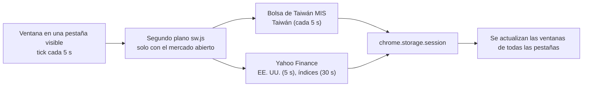

# 📈 PeekaStock

**Mira la bolsa a escondidas en el trabajo: una pequeña ventana flotante en la esquina de cualquier página con cotizaciones en tiempo real de Taiwán y EE. UU. e índices mundiales, que se oculta con un atajo.**

**Ventana flotante que se puede mover y redimensionar**, **tecla del jefe**, **modo discreto**, **alertas de precio y grandes movimientos**, **lista de seguimiento con pestañas propias** e interfaz en seis idiomas. Solo cotizaciones: no opera.

[](manifest.json)
[](#-instalación)
[](#-privacidad)
[](LICENSE)
[](#-idiomas-de-la-interfaz)

[繁體中文](README.md) · [English](README.en.md) · [日本語](README.ja.md) · [简体中文](README.zh-Hans.md) · [한국어](README.ko.md) · **Español**

[Por qué](#-por-qué) · [Funciones](#-funciones) · [Fuentes y retraso](#-fuentes-de-datos-y-retraso) · [Instalación](#-instalación) · [Uso](#-uso) · [Permisos](#-permisos) · [Limitaciones](#-limitaciones-conocidas) · [Privacidad](#-privacidad) · [Desarrollo](#-desarrollo)

---

## 💡 Por qué

Quería echar un vistazo al mercado durante el trabajo, pero abrir una aplicación de bolsa llama la atención y las cotizaciones web gratuitas suelen ir 15–20 minutos atrasadas. Así que hice una pequeña ventana que flota en la esquina de la página que estoy leyendo y desaparece con un atajo cuando alguien pasa.

> [!NOTE]
> **Sin cuenta, sin clave de API, sin servidor y gratis.** Las cotizaciones se obtienen directamente de las interfaces web públicas de la Bolsa de Taiwán y Yahoo Finance, sin pasar por servidores de terceros.

## ✨ Funciones

- **En todas las páginas**: la ventana aparece en la esquina de cada pestaña y todas comparten posición y tamaño. Se arrastra, se redimensiona desde cualquier esquina y sigue visible en vídeos a pantalla completa.
- **Tecla del jefe**: pulsa **Alt+Shift+H** (o el icono de PeekaStock en la barra) para ocultar la ventana en todas las pestañas a la vez. Mientras está oculta no se descarga nada.
- **Modo discreto ◐**: fondo transparente, texto gris y ▲▼ en lugar de colores; parece parte de la página.
- **Vista mini ▁**: la ventana se reduce a las orejas del gato y una línea, con una cotización distinta cada 4 s.
- **Alertas**: si una cotización se mueve más de ±3% (ajustable) o llega a tu precio objetivo, aparece un bocadillo con una huella de gato (p. ej. «¡NVDA sube ▲3.2%!»); en modo discreto solo se resalta la fila. No usa notificaciones del sistema.
- **Lista de seguimiento**: escribe `2330` o `AAPL` para añadir; detecta automáticamente si cotiza en TWSE, TPEx o EE. UU. Las acciones de EE. UU. muestran el ticker y las de Taiwán el nombre.
- **Pestañas**: `Todo | Taiwán | EE. UU. | Mundo`, más tus propias pestañas (p. ej. «Tecnología», «Dividendos»). Una acción puede estar en varias pestañas.
- **Índices mundiales**: 16 índices de Taiwán, EE. UU., China, Hong Kong, Japón, Corea, Singapur, Reino Unido, Francia y Alemania; cada uno se puede activar o desactivar.
- **Colores**: rojo sube, verde baja (convención de Taiwán) o verde sube, rojo baja (convención de EE. UU.).
- **Idiomas**: 繁中 / English / 日本語 / 简中 / 한국어 / Español; por defecto sigue el idioma de Chrome.

## ⏱️ Fuentes de datos y retraso

| Elemento | Fuente | Retraso medido (oct. 2026) |
|---|---|---|
| Acciones de Taiwán, TAIEX, índice TPEx | Bolsa de Taiwán, «Market Information System» (MIS) | de unos segundos a 2 minutos |
| Acciones de EE. UU., Dow Jones, S&P 500, Nasdaq, Semiconductores PHLX | Yahoo Finance | unos segundos |
| Shanghái, Shenzhen, CSI 300, Hang Seng, Nikkei, Straits Times, FTSE, CAC, DAX | Yahoo Finance | unos 15 minutos |
| KOSPI | Yahoo Finance | unos 20 minutos |

- Cada fila muestra la **hora del dato**; durante la sesión, los datos con más de 2 minutos se ven en gris.
- Las acciones de Taiwán a menudo no tienen precio de operación durante la sesión; entonces se muestra la mejor compra (o venta), marcada con «C» o «V».
- Los mercados cerrados no se consultan. Si ninguna pestaña está en primer plano o la ventana está oculta, no se envía ninguna petición.



## 🚀 Instalación

PeekaStock aún no está en Chrome Web Store. Instálalo con «Cargar descomprimida»:

### 1. Descargar

Pulsa **[⬇ Descargar ZIP](https://github.com/Ashur5457/PeekaStock/archive/refs/heads/main.zip)** y descomprímelo (obtendrás la carpeta `PeekaStock-main`). Con git: `git clone https://github.com/Ashur5457/PeekaStock.git`

### 2. Activar el modo de desarrollador

Abre `chrome://extensions` y activa el **Modo de desarrollador** (arriba a la derecha)


### 3. Cargar

Pulsa **Cargar descomprimida** y elige la carpeta `PeekaStock-main` (la que contiene directamente `manifest.json`)

### 4. Fijar el icono

Pulsa el botón de pieza de puzle 🧩 de la barra y fija PeekaStock (el icono oculta o muestra la ventana)

### 5. Recargar las páginas

**Recarga** las páginas que ya tengas abiertas; la ventana aparece abajo a la derecha

## 🎬 Uso

1. Pasa el ratón sobre la ventana para ver la barra: **⚙** ajustes, **▁** vista mini, **◐** modo discreto, **👁** ocultar, **↺** restablecer posición. Arrastra la barra (la cabeza del gato) para mover la ventana.
2. **⚙ Ajustes**:
   - **Lista de seguimiento**: escribe un código y pulsa Añadir; ↑↓ para ordenar, ✕ para quitar
   - **Pestañas propias**: añadir, ✎ renombrar, ↑↓, ✕; en «Añadir a la pestaña» marca las acciones e índices que quieras incluir
   - **Índices**: actívalos o desactívalos uno a uno
   - **Alertas**: grandes movimientos ±% (3% por defecto); para una alerta de precio pulsa 🔔 en la fila y fija un precio superior/inferior; con «En segundo plano» activado, los valores con alerta se comprueban cada minuto aunque no veas la ventana (solo con el mercado abierto) y el aviso aparece la próxima vez que la veas
   - **Vista**: idioma y colores
3. **Tecla del jefe Alt+Shift+H**: oculta la ventana en todas las pestañas; pulsa otra vez para mostrarla. El icono de PeekaStock hace lo mismo.

> [!TIP]
> Si Alt+Shift+H no hace nada, puede que otra extensión lo use. Asigna otro atajo en `chrome://extensions/shortcuts`.

## 🔐 Permisos

Chrome avisa de que PeekaStock puede «leer y cambiar todos tus datos de todos los sitios web». Se debe a que la ventana se dibuja en **todas las páginas**, así que su script tiene que cargarse en todas ellas.

- La ventana solo dibuja cotizaciones; **no lee ni recopila el contenido de las páginas**.
- Solo se conecta a dos sitios: `mis.twse.com.tw` (Bolsa de Taiwán) y `query1.finance.yahoo.com` (Yahoo Finance).
- También usa el permiso `alarms`, solo si activas las alertas en segundo plano: despierta el proceso en segundo plano una vez por minuto.

## ⚠️ Limitaciones conocidas

- **Ambas fuentes son interfaces no oficiales**: si la Bolsa de Taiwán o Yahoo cambian el formato, las cotizaciones pueden dejar de llegar; la ventana muestra el error abajo.
- **No se tienen en cuenta los festivos**: en un festivo verás el cierre de la sesión anterior.
- **Los precios de EE. UU.** son precios en tiempo real de un único mercado (Nasdaq) y pueden diferir ligeramente del precio consolidado de tu bróker.
- **Los índices fuera de EE. UU.** ya llegan con 15–20 minutos de retraso en Yahoo.
- **Páginas donde no aparece la ventana**: páginas `chrome://`, la página de Nueva pestaña, Chrome Web Store y el visor de PDF integrado.
- Hasta 100 acciones en la lista y 10 pestañas propias.
- Las traducciones de la interfaz y del README distintas del chino tradicional las generó una IA; se agradecen correcciones de hablantes nativos.

## 🔒 Privacidad

- **No se recopila ningún dato**: sin estadísticas, rastreo ni anuncios.
- A la Bolsa de Taiwán y a Yahoo solo se envían códigos de acciones (p. ej. `2330`, `AAPL`), igual que si abrieras sus páginas tú mismo.
- Los ajustes (lista, pestañas, posición, idioma) se guardan en el almacenamiento local de Chrome (`chrome.storage.local`); las cotizaciones solo se guardan en memoria (`chrome.storage.session`) y se borran al cerrar el navegador.

## 📜 Aviso legal

PeekaStock solo muestra cotizaciones y **no es asesoramiento de inversión**. Las cotizaciones pueden llegar con retraso, ser erróneas o no estar disponibles; guíate por tu bróker o por la bolsa. Este proyecto no tiene relación con la Bolsa de Taiwán ni con Yahoo.

## 📂 Archivos

```
PeekaStock/
├── manifest.json         # Manifiesto de la extensión (MV3)
├── sw.js                 # Segundo plano: programación, descarga, tecla del jefe, búsqueda de códigos
├── sources.js            # Fuentes: MIS de la Bolsa de Taiwán, Yahoo spark (análisis y códigos de error)
├── schedule.js           # Qué descargar en cada tick (mercado abierto, intervalo, espera tras fallos)
├── markets.js            # Tabla de mercados (zonas horarias, sesiones), tabla de índices
├── prefs.js              # Ajustes; operaciones de la lista y las pestañas
├── overlay.js            # Ventana flotante (Shadow DOM): arrastrar, redimensionar, pestañas, tabla
├── panel.js              # Panel de ajustes ⚙
├── alerts.js             # Reglas de alerta: precio, grandes movimientos, una vez al día
├── box.js                # Cálculo de posición y tamaño de la ventana
├── i18n.js               # Textos de la interfaz (una línea por frase, seis idiomas en paralelo)
├── _locales/             # Descripción y texto del atajo en seis idiomas
├── icons/                # Iconos de la extensión
├── tools/test.mjs        # Pruebas: node tools/test.mjs
├── tools/probe.mjs       # Medición de fuentes: node tools/probe.mjs
├── tools/make_icons.ps1  # Generador de iconos (PowerShell)
└── CLAUDE.md             # Notas de desarrollo (chino tradicional): requisitos, arquitectura, mediciones, trampas
```

## 🛠️ Desarrollo

Sin herramientas de compilación ni paquetes: tras editar, pulsa 🔄 en `chrome://extensions` y **recarga la página**.

- Pruebas: `node tools/test.mjs` (Node.js 18+). Ejecuta todo el flujo con respuestas de formato real y comprueba que no falten traducciones.
- Medición de fuentes: `node tools/probe.mjs` muestra el retraso de cada código y si cada servicio admite varios códigos a la vez.

Lee primero [`CLAUDE.md`](CLAUDE.md) (en chino tradicional): contiene las mediciones y las **trampas** encontradas. Algunas reglas:

1. **Debe seguir siendo gratis**: sin API de pago, sin claves de API para el usuario, sin servidores, sin recopilar datos.
2. **Todo el texto de la interfaz va en `i18n.js`**: una prueba falla si el código contiene chino sin traducir.
3. **Los botones de la zona de cotizaciones usan `pointerdown`**: las cotizaciones se redibujan cada pocos segundos y `click` no es fiable.
4. **Limita los estilos compartidos por tipo de elemento**: el panel de ajustes y la ventana comparten un Shadow DOM.
5. **Añade una marca de tiempo a las URL**: las cachés intermedias reutilizan las respuestas de Yahoo; sin ella recibirás datos viejos.

## 🌐 Idiomas de la interfaz

繁體中文, English, 日本語, 简体中文, 한국어, Español. Las traducciones distintas del chino tradicional las generó una IA. Si eres hablante nativo y ves algo poco natural, abre un Issue o un Pull Request para `i18n.js`, `_locales/` y el README correspondiente.

## 📄 Licencia

[MIT](LICENSE) © 2026 Ashur5457
