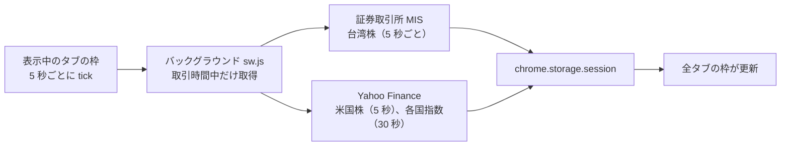

# 📈 PeekaStock

**仕事中にこっそり相場チェック：どのページの隅にも小さな枠を浮かべ、台湾株・米国株のリアルタイム株価と各国の指数を表示。ワンキーで隠せます。**

**ドラッグ・サイズ変更できるフローティング枠**、**ボスキー**、**ステルス表示**、**価格・急騰急落アラート**、**ウォッチリストとカスタムタブ**、UI は 6 言語対応。株価を見るだけで、売買はしません。

[](manifest.json)
[](#-インストール)
[](#-プライバシー)
[](LICENSE)
[](#-ui-の言語)

[繁體中文](README.md) · [English](README.en.md) · **日本語** · [简体中文](README.zh-Hans.md) · [한국어](README.ko.md) · [Español](README.es.md)

[作った理由](#-作った理由) · [できること](#-できること) · [データソースと遅延](#-データソースと遅延) · [インストール](#-インストール) · [使い方](#-使い方) · [権限](#-権限について) · [既知の制限](#-既知の制限) · [プライバシー](#-プライバシー) · [開発](#-開発)

---

## 💡 作った理由

仕事中に相場をちらっと見たいけれど、取引アプリを開くのは目立つし、無料の Web 株価は 15～20 分遅れのことが多い。そこで、読んでいるページの隅に浮かぶ小さな枠を作りました。誰かが通りかかったら、ショートカットキー一つで隠せます。

> [!NOTE]
> **アカウント不要、API キー不要、サーバー不要、無料です。**株価は台湾証券取引所と Yahoo Finance の公開 Web インターフェースから直接取得し、第三者のサーバーを経由しません。

## ✨ できること

- **どのページにも表示**：すべてのタブの隅に枠が表示され、位置とサイズは全タブで共通。ドラッグで移動、四隅でサイズ変更でき、全画面の動画でも表示されます。
- **ボスキー**：**Alt+Shift+H**（またはツールバーの PeekaStock アイコン）で全タブの枠を一斉に隠します。隠している間はデータを取得しません。
- **ステルス表示 ◐**：背景は透明、文字はグレー、騰落は色を使わず ▲▼ だけ。ページの一部のように見えます。
- **ミニ表示 ▁**：枠が猫耳と 1 行だけになり、4 秒ごとに次の銘柄を表示。
- **アラート**：騰落率が ±3%（変更可）を超えたり、指定した価格に届いたりすると、枠の中に肉球の吹き出し（例：「NVDA 急騰 ▲3.2%！」）。ステルス表示ではその行を強調するだけ。システム通知は使いません。
- **ウォッチリスト**：`2330` や `AAPL` と入力するだけで追加。上場（TWSE）／店頭（TPEx）／米国株を自動判別します。米国株はティッカー、台湾株は銘柄名で表示。
- **タブ**：`すべて｜台湾｜米国｜海外` に加え、自分でタブを作れます（例：「ハイテク」「高配当」）。同じ銘柄を複数のタブに入れられます。
- **各国の指数**：台湾・米国・中国・香港・日本・韓国・シンガポール・英国・フランス・ドイツの計 16 指数。個別にオン／オフできます。
- **騰落の色**：赤が上昇・緑が下落（台湾式）、または緑が上昇・赤が下落（米国式）。
- **表示言語**：繁中／English／日本語／简中／한국어／Español。既定は Chrome の言語に合わせます。

## ⏱️ データソースと遅延

| 項目 | データソース | 実測の遅延（2026 年 10 月） |
|---|---|---|
| 台湾株、台湾加権指数、TPEx 指数 | 台湾証券取引所「基本市況報導」（MIS） | 数秒～2 分 |
| 米国株、NY ダウ、S&P 500、ナスダック、SOX 指数 | Yahoo Finance | 数秒 |
| 上海総合、深セン成分、CSI 300、ハンセン、日経平均、STI、FTSE、CAC、DAX | Yahoo Finance | 約 15 分 |
| KOSPI | Yahoo Finance | 約 20 分 |

- 各行に**データの時刻**を表示。取引時間中に 2 分以上古いデータはグレーになり、どれが古いかすぐ分かります。
- 台湾株は取引時間中に約定値がないことが多く、その場合は最良買い（または売り）気配を表示して「買」「売」と示します。
- 取引時間外の市場は取得しません。前面にタブがないとき、または枠を隠しているときは、一切リクエストを送りません。



## 🚀 インストール

まだ Chrome ウェブストアには公開していません。「パッケージ化されていない拡張機能を読み込む」でインストールします：

### 1. ダウンロード

**[⬇ ZIP をダウンロード](https://github.com/Ashur5457/PeekaStock/archive/refs/heads/main.zip)** して解凍します（`PeekaStock-main` フォルダができます）。git を使う場合は `git clone https://github.com/Ashur5457/PeekaStock.git`

### 2. デベロッパー モードをオン

アドレスバーに `chrome://extensions` と入力し、右上の「**デベロッパー モード**」をオン


### 3. 読み込む

「**パッケージ化されていない拡張機能を読み込む**」で `PeekaStock-main` フォルダ（`manifest.json` が直下にあるもの）を選択

### 4. アイコンを固定

ツールバーのパズルボタン 🧩 から PeekaStock をピン留め（アイコンを押すと枠の表示／非表示）

### 5. ページを再読み込み

開いているページを**再読み込み**すると、右下に枠が表示されます

## 🎬 使い方

1. 枠にマウスを乗せると上端にツールバーが出ます：**⚙** 設定、**▁** ミニ表示、**◐** ステルス表示、**👁** 隠す、**↺** 位置をリセット。ツールバー（猫の顔）をドラッグすると枠を移動できます。
2. **⚙ 設定**：
   - **ウォッチリスト**：コードを入力して「追加」、↑↓ で並べ替え、✕ で削除
   - **カスタムタブ**：追加、✎ 名前変更、↑↓、✕。「タブに入れる」で入れる銘柄と指数を選択
   - **指数**：個別にオン／オフ
   - **アラート**：急騰・急落 ±%（初期値 3%）。価格アラートはウォッチリストの行の 🔔 で上限／下限を設定。「バックグラウンド」をオンにすると、枠が見えないときも取引時間中は 1 分ごとにアラート設定銘柄を確認し、次に枠が見えたときに表示
   - **表示**：表示言語、騰落の色
3. **ボスキー Alt+Shift+H**：全タブの枠を隠し、もう一度押すと再表示。ツールバーの PeekaStock アイコンでも同じです。

> [!TIP]
> Alt+Shift+H が効かない場合は、他の拡張機能が使っているかもしれません。`chrome://extensions/shortcuts` で別のショートカットを設定してください。

## 🔐 権限について

インストール時に「すべてのウェブサイト上にある自分のデータの読み取りと変更」と表示されます。PeekaStock は**すべてのページ**に株価の枠を描くため、枠のスクリプトをすべてのページに入れる必要があるからです。

- 枠は株価を描くだけで、**ページの内容を読み取ったり収集したりしません**。
- 接続するのは `mis.twse.com.tw`（台湾証券取引所）と `query1.finance.yahoo.com`（Yahoo Finance）の 2 つだけです。
- `alarms` 権限も使います：バックグラウンドのアラートをオンにしたときだけ、1 分ごとにバックグラウンド処理を起こします。

## ⚠️ 既知の制限

- **データソースはどちらも非公式のインターフェース**です。取引所や Yahoo が形式を変えると取得できなくなることがあり、その場合は枠の下部にエラーを表示します。
- **祝日には対応していません**：休場日は前営業日の終値が表示されます。
- **米国株の価格**は Nasdaq 単一取引所のリアルタイム価格で、証券会社が表示する全市場の価格とわずかに異なることがあります。
- **米国以外の指数**は Yahoo 自体が 15～20 分遅れです。
- **枠を表示できないページ**：`chrome://` で始まるページ、新しいタブ、Chrome ウェブストア、内蔵 PDF ビューアー。
- ウォッチリストは最大 100 銘柄、カスタムタブは最大 10 個です。
- 繁体字中国語以外の UI と README の翻訳は AI によるものです。ネイティブの方の修正を歓迎します。

## 🔒 プライバシー

- **データは一切収集しません**。統計・トラッキング・広告もありません。
- 取引所と Yahoo に送るのは銘柄コード（例：`2330`、`AAPL`）だけで、自分でそのサイトを開くのと同じです。
- 設定（ウォッチリスト、タブ、位置、言語）は Chrome のローカルストレージ（`chrome.storage.local`）に保存。株価はメモリ（`chrome.storage.session`）にだけ一時保存し、ブラウザを閉じると消えます。

## 📜 免責事項

PeekaStock は株価を表示するだけで、**投資助言ではありません**。株価は遅延・誤り・中断の可能性があります。証券会社や取引所のデータを正としてください。本プロジェクトは台湾証券取引所および Yahoo とは一切関係ありません。

## 📂 ファイル構成

```
PeekaStock/
├── manifest.json         # 拡張機能の設定（MV3）
├── sw.js                 # バックグラウンド：スケジュール、株価取得、ボスキー、コード照会
├── sources.js            # データソース：証券取引所 MIS、Yahoo spark（解析とエラーコード）
├── schedule.js           # 今回どれを取得するか（取引時間、間隔、失敗時の待機）
├── markets.js            # 市場表（タイムゾーン、取引時間）、指数表
├── prefs.js              # 設定、ウォッチリストとタブの操作
├── overlay.js            # フローティング枠（Shadow DOM）：ドラッグ、サイズ変更、タブ、株価表
├── panel.js              # ⚙ 設定パネル
├── alerts.js             # アラート：価格、急騰・急落、1 日 1 回
├── box.js                # 枠の位置とサイズの計算
├── i18n.js               # UI の文字列（1 行 1 文、6 言語を並べて記述）
├── _locales/             # 拡張機能の説明・ショートカット説明の 6 言語テキスト
├── icons/                # 拡張機能のアイコン
├── tools/test.mjs        # テスト：node tools/test.mjs
├── tools/probe.mjs       # データソースの実測：node tools/probe.mjs
├── tools/make_icons.ps1  # アイコン生成（PowerShell）
└── CLAUDE.md             # 開発ドキュメント（繁体字中国語）：要件、設計、実測結果、ハマりどころ
```

## 🛠️ 開発

ビルドツールもパッケージも不要です。編集したら `chrome://extensions` で 🔄 を押し、**ページを再読み込み**します。

- テスト：`node tools/test.mjs`（Node.js 18 以上）。実際の形式のレスポンスで全体の流れを動かし、翻訳漏れもチェックします。
- データソースの実測：`node tools/probe.mjs` で各コードの遅延や、エンドポイントが複数銘柄を一度に取得できるかを表示します。

開発前に [`CLAUDE.md`](CLAUDE.md)（繁体字中国語）を読んでください。実測結果と**ハマりどころ**がまとまっています。主なルール：

1. **無料であること**：有料 API、ユーザーの API キー、サーバー、データ収集は使いません。
2. **UI の文字列はすべて `i18n.js` に**：コード内に翻訳漏れの中国語があるとテストが失敗します。
3. **株価エリアのボタンは `pointerdown`**：株価は数秒ごとに再描画されるため、`click` は不安定です。
4. **共通スタイルは要素の種類で限定**：設定パネルと枠は同じ Shadow DOM にあります。
5. **リクエスト URL にタイムスタンプを付ける**：Yahoo の応答は途中のキャッシュで再利用されるため、付けないと古いデータになります。

## 🌐 UI の言語

繁體中文、English、日本語、简体中文、한국어、Español。繁体字中国語以外は AI による翻訳です。ネイティブの方で不自然な点に気づいたら、`i18n.js`、`_locales/`、対応する README の修正 Issue や Pull Request を歓迎します。

## 📄 ライセンス

[MIT](LICENSE) © 2026 Ashur5457
