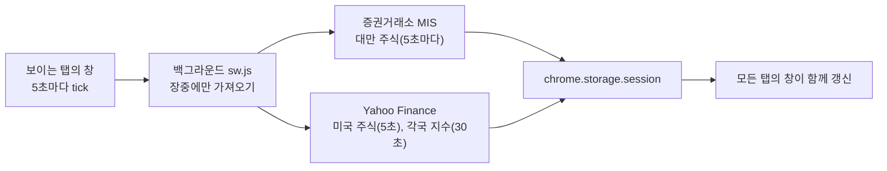

# 📈 PeekaStock

**근무 중 몰래 시세 확인: 어떤 웹페이지 구석에나 작은 창을 띄워 대만·미국 주식 실시간 시세와 각국 지수를 보여 주고, 단축키 하나로 숨길 수 있습니다.**

**드래그·크기 조절이 되는 플로팅 창**, **숨기기 키**, **스텔스 모드**, **가격·급등락 알림**, **관심종목과 사용자 탭**, 6개 언어 UI. 시세만 보고, 주문은 하지 않습니다.

[](manifest.json)
[](#-설치)
[](#-개인정보)
[](LICENSE)
[](#-ui-언어)

[繁體中文](README.md) · [English](README.en.md) · [日本語](README.ja.md) · [简体中文](README.zh-Hans.md) · **한국어** · [Español](README.es.md)

[만든 이유](#-만든-이유) · [기능](#-기능) · [데이터 출처와 지연](#-데이터-출처와-지연) · [설치](#-설치) · [사용법](#-사용법) · [권한](#-권한-안내) · [알려진 제한](#-알려진-제한) · [개인정보](#-개인정보) · [개발](#-개발)

---

## 💡 만든 이유

근무 중에 시세를 슬쩍 보고 싶은데, 증권 앱을 열면 눈에 띄고 무료 웹 시세는 15~20분씩 늦는 경우가 많습니다. 그래서 보고 있는 웹페이지 구석에 떠 있는 작은 창을 만들었습니다. 누가 지나가면 단축키 한 번으로 숨기면 됩니다.

> [!NOTE]
> **계정도, API 키도, 서버도 필요 없고 무료입니다.** 시세는 대만증권거래소와 Yahoo Finance의 공개 웹 인터페이스에서 바로 가져오며, 제3자 서버를 거치지 않습니다.

## ✨ 기능

  

- **모든 웹페이지에 표시**: 모든 탭의 구석에 창이 나타나고, 위치와 크기는 모든 탭이 공유합니다. 드래그로 이동, 네 모서리로 크기 조절이 되며 전체 화면 동영상에서도 보입니다.
- **숨기기 키**: **Alt+Shift+H**(또는 툴바의 PeekaStock 아이콘)를 누르면 모든 탭의 창이 한꺼번에 숨겨집니다. 숨긴 동안에는 데이터를 가져오지 않습니다.
- **빈 곳 두 번 클릭**: 페이지의 빈 곳을 두 번 클릭해도 숨기기／표시할 수 있습니다(글자·링크·입력란·동영상 위는 제외, 설정에서 끌 수 있음).
- **Esc 두 번**: 페이지에 포커스가 있을 때 Esc를 빠르게 두 번 누르면 숨기기／표시. 설정에서 원하는 키(Esc 한 번, F2 등)로 바꿀 수 있습니다.
- **스텔스 모드 ◐**: 배경은 투명, 글자는 회색, 등락은 색 없이 ▲▼만 사용해 웹페이지의 일부처럼 보입니다.
- **미니 보기 ▁**: 창이 고양이 귀와 한 줄만 남고, 4초마다 다음 종목을 보여 줍니다.
- **알림**: 등락률이 ±3%(조정 가능)를 넘거나 설정한 가격에 도달하면 창 안에 고양이 발바닥 말풍선(예: "NVDA 급등 ▲3.2%!")이 뜹니다. 스텔스 모드에서는 그 줄만 강조됩니다. 시스템 알림은 쓰지 않습니다.
- **관심종목**: `2330`이나 `AAPL`을 입력하면 추가되고, 상장(TWSE)／장외(TPEx)／미국 주식을 자동으로 구분합니다. 미국 주식은 티커, 대만 주식은 종목명으로 표시합니다.
- **탭**: `전체｜대만｜미국｜해외`에 더해 직접 탭을 만들 수 있습니다(예: "기술주", "배당주"). 한 종목을 여러 탭에 넣을 수 있습니다.
- **각국 지수**: 대만, 미국, 중국, 홍콩, 일본, 한국, 싱가포르, 영국, 프랑스, 독일의 16개 지수를 각각 켜고 끌 수 있습니다.
- **등락 색상**: 빨강 상승·초록 하락(대만식) 또는 초록 상승·빨강 하락(미국식).
- **UI 언어**: 繁中／English／日本語／简中／한국어／Español. 기본값은 Chrome의 언어를 따릅니다.

## ⏱️ 데이터 출처와 지연

| 항목 | 출처 | 실측 지연(2026년 10월) |
|---|---|---|
| 대만 주식, 대만 가권지수, 장외지수 | 대만증권거래소 "기본시황보도"(MIS) | 몇 초~2분 |
| 미국 주식, 다우존스, S&P 500, 나스닥, 필라델피아 반도체 | Yahoo Finance | 몇 초 |
| 상하이종합, 선전성분, CSI 300, 항셍, 닛케이, STI, FTSE, CAC, DAX | Yahoo Finance | 약 15분 |
| 코스피 | Yahoo Finance | 약 20분 |

- 모든 행에 **데이터 시각**을 표시합니다. 장중에 2분 넘게 지난 데이터는 회색이 되어 어느 것이 오래됐는지 바로 알 수 있습니다.
- 대만 주식은 장중에 체결가가 없는 경우가 많아, 이때는 최우선 매수(또는 매도) 호가를 표시하고 "매수" "매도"로 표시합니다.
- 장이 닫힌 시장은 가져오지 않습니다. 앞에 보이는 탭이 없거나 창을 숨겼을 때는 요청을 전혀 보내지 않습니다.



## 🚀 설치

아직 Chrome 웹 스토어에는 올리지 않았습니다. "압축해제된 확장 프로그램을 로드합니다"로 설치하세요:

### 1. 다운로드

**[⬇ ZIP 다운로드](https://github.com/Ashur5457/PeekaStock/archive/refs/heads/main.zip)** 후 압축을 풉니다(`PeekaStock-main` 폴더가 생깁니다). git을 쓴다면 `git clone https://github.com/Ashur5457/PeekaStock.git`

### 2. 개발자 모드 켜기

주소창에 `chrome://extensions`를 입력하고 오른쪽 위의 **개발자 모드**를 켭니다


### 3. 로드

**압축해제된 확장 프로그램을 로드합니다**를 누르고 `PeekaStock-main` 폴더(`manifest.json`이 바로 보이는 폴더)를 선택합니다


### 4. 아이콘 고정

툴바의 퍼즐 버튼 🧩에서 PeekaStock을 고정합니다(아이콘을 누르면 창 숨기기／표시)


### 5. 페이지 새로고침

이미 열려 있는 페이지를 **새로고침**하면 오른쪽 아래에 창이 나타납니다

## 🎬 사용법

1. 창에 마우스를 올리면 위쪽에 툴바가 나타납니다: **⚙** 설정, **▁** 미니 보기, **◐** 스텔스 모드, **👁** 숨기기, **↺** 위치 초기화, **?** 사용 방법. 툴바(고양이 얼굴)를 드래그하면 창을 옮길 수 있습니다.
2. **⚙ 설정**:
   - **관심종목**: 코드를 입력하고 "추가", ↑↓로 순서 변경, ✕로 삭제
   - **사용자 탭**: 추가, ✎ 이름 변경, ↑↓, ✕. "탭에 넣기"에서 넣을 종목과 지수를 선택
   - **지수**: 각각 켜기／끄기
   - **알림**: 급등락 ±%(기본 3%). 가격 알림은 관심종목 줄의 🔔에서 상한/하한 설정. "백그라운드"를 켜면 창이 안 보일 때도 장중 1분마다 알림 설정 종목을 확인하고, 다음에 창이 보일 때 표시
   - **표시**: UI 언어, 등락 색상
3. **숨기기 키 Alt+Shift+H**: 모든 탭의 창을 숨기고, 다시 누르면 나타납니다. 툴바의 PeekaStock 아이콘도 같습니다.


> [!TIP]
> Alt+Shift+H가 동작하지 않으면 다른 확장 프로그램이 쓰고 있을 수 있습니다. `chrome://extensions/shortcuts`에서 다른 단축키를 지정하세요.

## 🔐 권한 안내

설치할 때 Chrome이 "모든 웹사이트에 있는 내 데이터 읽기 및 변경" 권한을 알립니다. PeekaStock은 **모든 웹페이지**에 시세 창을 그려야 하므로, 창의 스크립트를 모든 페이지에 넣어야 하기 때문입니다.

- 창은 시세만 그리며, **웹페이지 내용을 읽거나 수집하지 않습니다**.
- 접속하는 사이트는 `mis.twse.com.tw`(대만증권거래소)와 `query1.finance.yahoo.com`(Yahoo Finance) 두 곳뿐입니다.
- `alarms` 권한도 사용합니다: 백그라운드 알림을 켰을 때만 1분마다 백그라운드 스크립트를 깨웁니다.

## ⚠️ 알려진 제한

- **두 데이터 출처 모두 비공식 인터페이스**입니다. 거래소나 Yahoo가 형식을 바꾸면 시세를 가져오지 못할 수 있으며, 이때 창 아래쪽에 오류를 표시합니다.
- **공휴일은 처리하지 않습니다**: 휴장일에는 직전 거래일의 종가가 보입니다.
- **미국 주식 가격**은 Nasdaq 단일 거래소의 실시간 가격이라, 증권사가 보여 주는 전체 시장 가격과 약간 다를 수 있습니다.
- **미국 외 지수**는 Yahoo 자체가 15~20분 지연됩니다.
- **창을 표시할 수 없는 페이지**: `chrome://`로 시작하는 페이지, 새 탭, Chrome 웹 스토어, 내장 PDF 뷰어.
- 관심종목은 최대 100개, 사용자 탭은 최대 10개입니다.
- 번체 중국어 외의 UI와 README 번역은 AI가 만들었습니다. 원어민의 수정을 환영합니다.

## 🔒 개인정보

- **어떤 데이터도 수집하지 않습니다**. 통계, 추적, 광고가 없습니다.
- 거래소와 Yahoo에 보내는 것은 종목 코드(예: `2330`, `AAPL`)뿐이며, 직접 그 사이트를 여는 것과 같습니다.
- 설정(관심종목, 탭, 위치, 언어)은 Chrome의 로컬 저장소(`chrome.storage.local`)에 저장되고, 시세는 메모리(`chrome.storage.session`)에만 임시 저장되어 브라우저를 닫으면 지워집니다.

## 📜 면책 조항

PeekaStock은 시세만 표시하며 **투자 조언이 아닙니다**. 시세는 지연되거나 틀리거나 중단될 수 있으니 증권사나 거래소의 데이터를 기준으로 하세요. 이 프로젝트는 대만증권거래소 및 Yahoo와 아무 관계가 없습니다.

## 📂 파일 구조

```
PeekaStock/
├── manifest.json         # 확장 프로그램 설정(MV3)
├── sw.js                 # 백그라운드: 일정, 시세 가져오기, 숨기기 키, 코드 조회
├── sources.js            # 데이터 출처: 증권거래소 MIS, Yahoo spark(파싱과 오류 코드)
├── schedule.js           # 이번에 무엇을 가져올지(장중 여부, 간격, 실패 시 대기)
├── markets.js            # 시장 표(시간대, 거래 시간), 지수 표
├── prefs.js              # 설정, 관심종목과 탭 조작
├── overlay.js            # 플로팅 창(Shadow DOM): 드래그, 크기 조절, 탭, 시세 표
├── panel.js              # ⚙ 설정 패널
├── alerts.js             # 알림 규칙: 가격, 급등락, 하루 한 번
├── box.js                # 창 위치와 크기 계산
├── blank.js              # 두 번 클릭·Esc 숨기기 판정
├── i18n.js               # UI 문자열(한 줄에 한 문장, 6개 언어 나란히)
├── _locales/             # 확장 프로그램 설명·단축키 설명의 6개 언어 텍스트
├── icons/                # 확장 프로그램 아이콘
├── tools/test.mjs        # 테스트: node tools/test.mjs
├── tools/probe.mjs       # 데이터 출처 실측: node tools/probe.mjs
├── tools/make_icons.ps1  # 아이콘 생성(PowerShell)
└── CLAUDE.md             # 개발 문서(번체 중국어): 요구사항, 구조, 실측 결과, 주의할 점
```

## 🛠️ 개발

빌드 도구도 패키지 설치도 필요 없습니다. 파일을 고친 뒤 `chrome://extensions`에서 🔄를 누르고 **페이지를 새로고침**하세요.

- 테스트: `node tools/test.mjs`(Node.js 18 이상). 실제 형식의 응답으로 전체 흐름을 돌리고, 번역 누락도 검사합니다.
- 데이터 출처 실측: `node tools/probe.mjs`로 코드별 지연과 엔드포인트가 여러 종목을 한 번에 가져올 수 있는지 출력합니다.

개발 전에 [`CLAUDE.md`](CLAUDE.md)(번체 중국어)를 읽어 주세요. 실측 결과와 **주의할 점**이 정리되어 있습니다. 주요 규칙:

1. **무료 유지**: 유료 API, 사용자 API 키, 서버, 데이터 수집을 쓰지 않습니다.
2. **UI 문자열은 모두 `i18n.js`에**: 코드에 번역되지 않은 중국어가 있으면 테스트가 실패합니다.
3. **시세 영역의 버튼은 `pointerdown`**: 시세가 몇 초마다 다시 그려져 `click`은 불안정합니다.
4. **공통 스타일은 요소 종류로 한정**: 설정 패널과 창이 같은 Shadow DOM에 있습니다.
5. **요청 URL에 타임스탬프 추가**: Yahoo 응답은 중간 캐시가 재사용하므로, 붙이지 않으면 오래된 데이터를 받습니다.

## 🌐 UI 언어

繁體中文, English, 日本語, 简体中文, 한국어, Español. 번체 중국어 외에는 AI 번역입니다. 원어민으로서 어색한 부분을 발견하면 `i18n.js`, `_locales/`, 해당 README를 고치는 Issue나 Pull Request를 환영합니다.

## 📄 라이선스

[MIT](LICENSE) © 2026 Ashur5457
