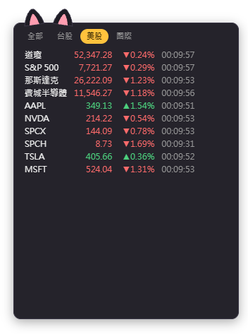
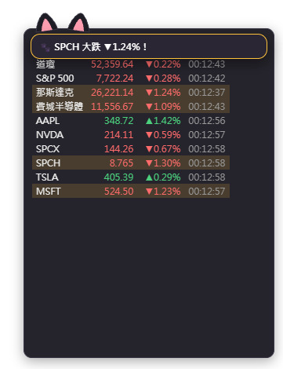
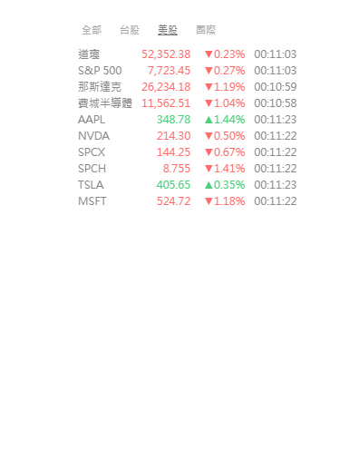
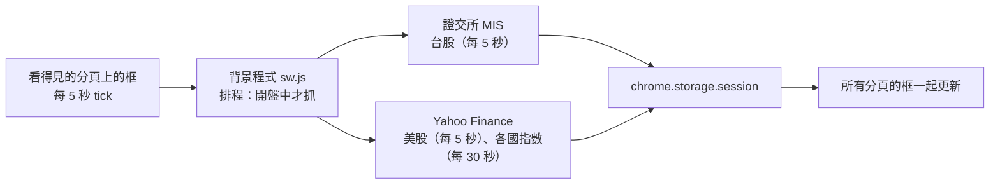
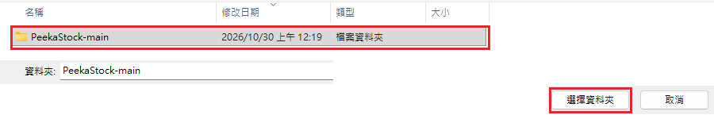
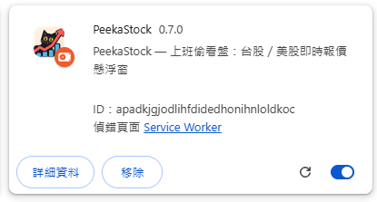
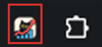
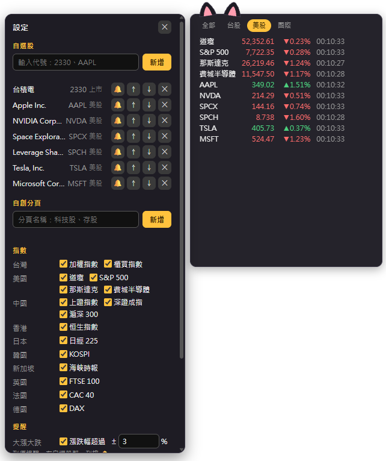

# 📈 PeekaStock（偷喵看盤）

**上班偷看盤：在任何網頁角落浮一個小框，看台股、美股即時報價和各國指數，一鍵就能藏起來。**

**可拖曳縮放的懸浮框**、**藏身鍵**、**隱身模式**、**到價與大漲大跌提醒**、**自選股與自創分頁**，介面支援六種語言。只看報價，不下單。

[](manifest.json)
[](#-安裝)
[](#-隱私)
[](LICENSE)
[](#-介面語言)

**繁體中文** · [English](README.en.md) · [日本語](README.ja.md) · [简体中文](README.zh-Hans.md) · [한국어](README.ko.md) · [Español](README.es.md)

[為什麼做](#-為什麼做) · [能做什麼](#-能做什麼) · [資料來源與延遲](#-資料來源與延遲) · [安裝](#-安裝) · [使用](#-使用) · [權限](#-為什麼要讀取和變更所有網站上的資料) · [已知限制](#-已知限制) · [隱私](#-隱私) · [開發](#-開發)

---

## 💡 為什麼做

上班時想瞄一眼盤，但開看盤軟體太顯眼，免費的網頁報價又常常延遲 15～20 分鐘。所以我做了一個小框：浮在正在看的網頁角落，有人經過就按一下快捷鍵藏起來。

> [!NOTE]
> **不需要帳號、不需要 API 金鑰、不需要架伺服器，也不用付費。**報價直接從證交所和 Yahoo Finance 的公開網頁介面抓，不經過任何第三方伺服器。

## ✨ 能做什麼

  

- **任何網頁都有**：框出現在每個分頁的角落，所有分頁共用同一個位置和大小。可拖曳、四個角都能縮放，全螢幕看影片時也在。
- **藏身鍵**：按 **Alt+Shift+H**（或點工具列的 PeekaStock 圖示），所有分頁的框同時藏起來；藏起來時完全不抓資料。
- **空白處點兩下**：在網頁空白的地方點兩下，也能藏起來或叫出來（點在文字、連結、輸入框、影片上不算；設定裡可以關掉）。
- **Esc 連按兩下**：游標在網頁裡時，快速按兩下 Esc 也能藏起來或叫出來；設定裡可以錄製成自己喜歡的鍵（例如單按 Esc、F2）。
- **隱身模式 ◐**：背景透明、文字變灰、漲跌只用 ▲▼ 不分顏色，看起來像網頁本身的小字。
- **迷你偷看 ▁**：框只剩貓耳朵和一行報價，每 4 秒換下一檔。
- **提醒**：漲跌超過 ±3%（可調）或到了你設的價格，框裡跳出貓掌泡泡（例如「台積電 大漲 ▲3.2%！」）；隱身模式時只把那一列標亮。不用系統通知。
- **自選股**：輸入 `2330` 或 `AAPL` 就能加入，自動判斷上市／上櫃／美股。美股顯示代號、台股顯示名稱。
- **分頁**：`全部｜台股｜美股｜國際`，還能自己新增分頁（例如「科技股」「存股」），同一檔可以放進好幾頁。
- **各國指數**：台灣、美國、中國、香港、日本、韓國、新加坡、英國、法國、德國共 16 個，可以逐一開關。
- **漲跌顏色**：紅漲綠跌（台灣習慣）或綠漲紅跌（美國習慣）。
- **介面語言**：繁中／English／日本語／简中／한국어／Español，預設跟著 Chrome 的語言。

## ⏱️ 資料來源與延遲

| 項目 | 來源 | 實測延遲（2026-10） |
|---|---|---|
| 台股個股、加權指數、櫃買指數 | 證交所「基本市況報導」（MIS） | 幾秒～2 分鐘 |
| 美股、道瓊、S&P 500、那斯達克、費城半導體 | Yahoo Finance | 幾秒 |
| 上證、深證、滬深 300、恒生、日經、海峽時報、FTSE、CAC、DAX | Yahoo Finance | 約 15 分鐘 |
| KOSPI | Yahoo Finance | 約 20 分鐘 |

- 每一列都顯示**資料時間**；盤中資料超過 2 分鐘就變灰，一眼看出哪個是舊的。
- 台股盤中常常沒有「成交價」，這時改顯示最佳買價（或賣價），並標上「買」「賣」。
- 休市的市場不抓；沒有分頁在前景、或框藏起來時，完全不發請求。



## 🚀 安裝

目前還沒上架 Chrome 線上應用程式商店，請用「載入未封裝項目」安裝：

### 1. 下載

點 **[⬇ 下載 ZIP](https://github.com/Ashur5457/PeekaStock/archive/refs/heads/main.zip)**，下載後解壓縮（會得到 `PeekaStock-main` 資料夾）。會用 git 的話也可以 `git clone https://github.com/Ashur5457/PeekaStock.git`

### 2. 開啟開發人員模式

Chrome 網址列輸入 `chrome://extensions`，打開右上角的「**開發人員模式**」


### 3. 載入

按「**載入未封裝項目**」，選 `PeekaStock-main` 資料夾（裡面要直接看得到 `manifest.json`）





### 4. 釘選圖示

按工具列的拼圖按鈕 🧩，把 PeekaStock 旁邊的圖釘點亮（之後點這個圖示就能藏起／叫出框）



### 5. 重新整理網頁

**重新整理**已經開著的網頁，框就會出現在右下角

## 🎬 使用

1. 滑鼠移到框上，上緣會出現工具列：**⚙** 設定、**▁** 迷你偷看、**◐** 隱身模式、**👁** 隱藏、**↺** 重設位置、**?** 使用說明。按住工具列（貓頭）可以拖動框。
2. **⚙ 設定**：
   - **自選股**：輸入代號按「新增」；↑↓ 排順序、✕ 刪除
   - **自創分頁**：新增、✎ 改名、↑↓、✕；在「放進分頁」勾選要放的股票和指數
   - **指數**：逐一開關
   - **提醒**：大漲大跌 ±%（預設 3%）；到價提醒在自選股那一列按 🔔 設上限／下限；打開「背景提醒」後，框看不見時也每 1 分鐘檢查有設提醒的股票（只在開盤時段），提醒在下次看到框時跳出
   - **顯示**：介面語言、漲跌顏色
3. **藏身鍵 Alt+Shift+H**：所有分頁的框一起藏起來，再按一次叫回來。也可以點工具列的 PeekaStock 圖示。



> [!TIP]
> 如果 Alt+Shift+H 沒反應，可能被其他擴充功能占用了。到 `chrome://extensions/shortcuts` 幫 PeekaStock 換一組快捷鍵。

## 🔐 為什麼要「讀取和變更所有網站上的資料」

安裝時 Chrome 會顯示這個權限。原因是 PeekaStock 要在**每一個網頁**上畫出報價框，所以框的程式必須放進所有網頁。

- 框只負責畫報價，**不讀取、不收集網頁的內容**。
- 會連線的網站只有兩個：`mis.twse.com.tw`（證交所）和 `query1.finance.yahoo.com`（Yahoo Finance）。
- 另外用到 `alarms`（鬧鐘）權限：只在你打開「背景提醒」時，每 1 分鐘叫醒背景程式檢查一次。

## ⚠️ 已知限制

- **兩個資料來源都是非官方介面**：證交所或 Yahoo 改了格式，報價就可能抓不到；框的底部會顯示錯誤。
- **國定假日沒有處理**：休市日看到的是前一個交易日的收盤。
- **美股價格**來自 Nasdaq 單一交易所的即時價，和券商顯示的全市場成交價可能有些微差異。
- **非美國的指數**在 Yahoo 上本來就延遲 15～20 分鐘。
- **畫不出框的頁面**：`chrome://` 開頭的頁面、新分頁、Chrome 線上應用程式商店、內建 PDF 檢視器。
- 自選股最多 100 檔，自創分頁最多 10 個。
- 繁中以外的介面和 README 翻譯由 AI 產生，歡迎母語者修正。

## 🔒 隱私

- **不收集任何資料**，沒有統計、追蹤或廣告。
- 送到證交所和 Yahoo 的只有股票代號（例如 `2330`、`AAPL`），就像你自己打開他們的網頁一樣。
- 設定（自選股、分頁、位置、語言）存在 Chrome 的本機儲存空間（`chrome.storage.local`）；報價只暫存在記憶體（`chrome.storage.session`），關掉瀏覽器就清空。

## 📜 免責聲明

PeekaStock 只顯示報價，**不構成任何投資建議**。報價可能延遲、錯誤或中斷，請以券商或交易所的資料為準。本專案與臺灣證券交易所、Yahoo 無任何關係。

## 📂 檔案結構

```
PeekaStock/
├── manifest.json         # 擴充功能設定（MV3）
├── sw.js                 # 背景程式：排程、抓報價、藏身鍵、查代號
├── sources.js            # 資料來源：證交所 MIS、Yahoo spark（解析與錯誤代碼）
├── schedule.js           # 排程：這次要抓哪些（開盤中、時間到、失敗退避）
├── markets.js            # 市場表（時區、交易時段）、指數表
├── prefs.js              # 設定、自選股與分頁的操作
├── overlay.js            # 懸浮框（Shadow DOM）：拖曳、縮放、分頁列、報價表
├── panel.js              # ⚙ 設定面板
├── alerts.js             # 提醒規則：到價、大漲大跌、一天只響一次
├── box.js                # 框的位置大小計算
├── blank.js              # 空白處點兩下、Esc 藏身的判斷
├── i18n.js               # 介面文字（每句一行，六種語言並排）
├── _locales/             # 擴充功能說明、快捷鍵說明的六語文字
├── icons/                # 擴充功能圖示
├── tools/test.mjs        # 測試：node tools/test.mjs
├── tools/probe.mjs       # 資料來源實測：node tools/probe.mjs
├── tools/make_icons.ps1  # 產生圖示（PowerShell）
└── CLAUDE.md             # 開發文件：需求、架構、實測結果、踩過的坑
```

## 🛠️ 開發

不需要建置工具，也不需要安裝套件：改完檔案後在 `chrome://extensions` 按 🔄 重新載入，再**重新整理網頁**。

- 測試：`node tools/test.mjs`（需要 Node.js 18 以上）。用真實格式的回應跑完整流程，也會檢查翻譯有沒有漏。
- 資料來源實測：`node tools/probe.mjs`，印出每個代號的延遲、端點能不能一次抓多檔。

開發前先讀 [`CLAUDE.md`](CLAUDE.md)，裡面有實測結果和**踩過的坑**。幾條規則：

1. **必須免費**：不用付費 API、不要求使用者申請金鑰、不架伺服器、不收集資料。
2. **介面文字一律放 `i18n.js`**：測試會檢查程式碼裡有沒有漏掉的中文。
3. **報價區的按鈕用 `pointerdown`**：報價每幾秒重畫，`click` 會失效。
4. **共用樣式要限定元素類型**：設定面板和框放在同一個 Shadow DOM，類別名稱容易撞到。
5. **請求網址要加時間戳記**：Yahoo 的回應會被中間的快取伺服器重複使用，不加就會拿到舊資料。

## 🌐 介面語言

繁體中文、English、日本語、简体中文、한국어、Español。繁中以外的翻譯由 AI 產生，如果你是母語者、發現不自然的地方，歡迎開 Issue 或 Pull Request 修正 `i18n.js`、`_locales/` 和對應的 README。

## 📄 授權

[MIT](LICENSE) © 2026 Ashur5457
