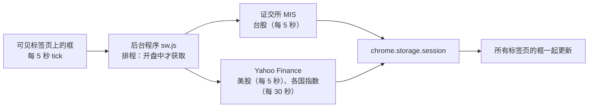

# 📈 PeekaStock（偷喵看盘）

**上班偷看盘：在任何网页角落浮一个小框，看台股、美股实时行情和各国指数，一键就能藏起来。**

**可拖动缩放的悬浮框**、**老板键**、**隐身外观**、**到价与大涨大跌提醒**、**自选股与自定义分页**，界面支持六种语言。只看行情，不下单。

[](manifest.json)
[](#-安装)
[](#-隐私)
[](LICENSE)
[](#-界面语言)

[繁體中文](README.md) · [English](README.en.md) · [日本語](README.ja.md) · **简体中文** · [한국어](README.ko.md) · [Español](README.es.md)

[为什么做](#-为什么做) · [能做什么](#-能做什么) · [数据来源与延迟](#-数据来源与延迟) · [安装](#-安装) · [使用](#-使用) · [权限](#-权限说明) · [已知限制](#-已知限制) · [隐私](#-隐私) · [开发](#-开发)

---

## 💡 为什么做

上班时想瞄一眼行情，但打开看盘软件太显眼，免费的网页行情又常常延迟 15～20 分钟。所以我做了一个小框：浮在正在看的网页角落，有人经过就按一下快捷键藏起来。

> [!NOTE]
> **不需要账号、不需要 API 密钥、不需要架服务器，也不用付费。**行情直接从台湾证券交易所和 Yahoo Finance 的公开网页接口获取，不经过任何第三方服务器。

## ✨ 能做什么

  

- **任何网页都有**：框出现在每个标签页的角落，所有标签页共用同一个位置和大小。可拖动、四个角都能缩放，全屏看视频时也在。
- **老板键**：按 **Alt+Shift+H**（或点工具栏的 PeekaStock 图标），所有标签页的框同时藏起来；藏起来时完全不获取数据。
- **隐身外观 ◐**：背景透明、文字变灰、涨跌只用 ▲▼ 不分颜色，看起来像网页本身的小字。
- **迷你偷看 ▁**：框只剩猫耳朵和一行行情，每 4 秒换下一只。
- **提醒**：涨跌超过 ±3%（可调）或到了你设的价格，框里弹出猫掌气泡（例如「台积电 大涨 ▲3.2%！」）；隐身外观时只把那一行标亮。不用系统通知。
- **自选股**：输入 `2330` 或 `AAPL` 就能加入，自动判断上市／上柜／美股。美股显示代码、台股显示名称。
- **分页**：`全部｜台股｜美股｜国际`，还能自己新建分页（例如「科技股」「存股」），同一只股票可以放进好几个分页。
- **各国指数**：台湾、美国、中国、香港、日本、韩国、新加坡、英国、法国、德国共 16 个，可以逐一开关。
- **涨跌颜色**：红涨绿跌（台湾习惯）或绿涨红跌（美国习惯）。
- **界面语言**：繁中／English／日本語／简中／한국어／Español，默认跟随 Chrome 的语言。

## ⏱️ 数据来源与延迟

| 项目 | 来源 | 实测延迟（2026-10） |
|---|---|---|
| 台股个股、台湾加权指数、柜买指数 | 台湾证券交易所「基本市况报导」（MIS） | 几秒～2 分钟 |
| 美股、道琼斯、标普 500、纳斯达克、费城半导体 | Yahoo Finance | 几秒 |
| 上证、深证、沪深 300、恒生、日经、海峡时报、富时 100、CAC、DAX | Yahoo Finance | 约 15 分钟 |
| KOSPI | Yahoo Finance | 约 20 分钟 |

- 每一行都显示**数据时间**；盘中数据超过 2 分钟就变灰，一眼看出哪个是旧的。
- 台股盘中常常没有「成交价」，这时改显示最佳买价（或卖价），并标上「买」「卖」。
- 休市的市场不获取；没有标签页在前台、或框藏起来时，完全不发请求。



## 🚀 安装

目前还没上架 Chrome 应用商店，请用「加载已解压的扩展程序」安装：

### 1. 下载

点 **[⬇ 下载 ZIP](https://github.com/Ashur5457/PeekaStock/archive/refs/heads/main.zip)**，下载后解压（会得到 `PeekaStock-main` 文件夹）。会用 git 的话也可以 `git clone https://github.com/Ashur5457/PeekaStock.git`

### 2. 打开开发者模式

Chrome 地址栏输入 `chrome://extensions`，打开右上角的「**开发者模式**」


### 3. 加载

点「**加载已解压的扩展程序**」，选 `PeekaStock-main` 文件夹（里面要直接看得到 `manifest.json`）


### 4. 固定图标

点工具栏的拼图按钮 🧩，把 PeekaStock 旁边的图钉点亮（之后点这个图标就能藏起／叫出框）


### 5. 刷新网页

**刷新**已经打开的网页，框就会出现在右下角

## 🎬 使用

1. 鼠标移到框上，上缘会出现工具栏：**⚙** 设置、**▁** 迷你偷看、**◐** 隐身外观、**👁** 隐藏、**↺** 重置位置。按住工具栏（猫头）可以拖动框。
2. **⚙ 设置**：
   - **自选股**：输入代码点「添加」；↑↓ 调整顺序、✕ 删除
   - **自定义分页**：添加、✎ 改名、↑↓、✕；在「放进分页」勾选要放的股票和指数
   - **指数**：逐一开关
   - **提醒**：大涨大跌 ±%（默认 3%）；到价提醒在自选股那一行按 🔔 设上限／下限；打开「后台提醒」后，框看不见时也每 1 分钟检查有设提醒的股票（只在开盘时段），提醒在下次看到框时弹出
   - **显示**：界面语言、涨跌颜色
3. **老板键 Alt+Shift+H**：所有标签页的框一起藏起来，再按一次叫回来。也可以点工具栏的 PeekaStock 图标。


> [!TIP]
> 如果 Alt+Shift+H 没反应，可能被其他扩展程序占用了。到 `chrome://extensions/shortcuts` 给 PeekaStock 换一组快捷键。

## 🔐 权限说明

安装时 Chrome 会提示「读取和更改您在所有网站上的数据」。原因是 PeekaStock 要在**每一个网页**上画出行情框，所以框的程序必须放进所有网页。

- 框只负责画行情，**不读取、不收集网页的内容**。
- 会连接的网站只有两个：`mis.twse.com.tw`（台湾证券交易所）和 `query1.finance.yahoo.com`（Yahoo Finance）。
- 另外用到 `alarms`（闹钟）权限：只在你打开「后台提醒」时，每 1 分钟唤醒后台程序检查一次。

## ⚠️ 已知限制

- **两个数据来源都是非官方接口**：证交所或 Yahoo 改了格式，行情就可能获取不到；框的底部会显示错误。
- **没有处理法定假日**：休市日看到的是前一个交易日的收盘。
- **美股价格**来自 Nasdaq 单一交易所的实时价，和券商显示的全市场成交价可能略有差异。
- **非美国的指数**在 Yahoo 上本来就延迟 15～20 分钟。
- **画不出框的页面**：`chrome://` 开头的页面、新标签页、Chrome 应用商店、内置 PDF 查看器。
- 自选股最多 100 只，自定义分页最多 10 个。
- 繁中以外的界面和 README 翻译由 AI 生成，欢迎母语者修正。

## 🔒 隐私

- **不收集任何数据**，没有统计、追踪或广告。
- 发送给证交所和 Yahoo 的只有股票代码（例如 `2330`、`AAPL`），就像你自己打开他们的网页一样。
- 设置（自选股、分页、位置、语言）存在 Chrome 的本地存储（`chrome.storage.local`）；行情只暂存在内存（`chrome.storage.session`），关闭浏览器就清空。

## 📜 免责声明

PeekaStock 只显示行情，**不构成任何投资建议**。行情可能延迟、错误或中断，请以券商或交易所的数据为准。本项目与台湾证券交易所、Yahoo 无任何关系。

## 📂 文件结构

```
PeekaStock/
├── manifest.json         # 扩展程序配置（MV3）
├── sw.js                 # 后台程序：排程、获取行情、老板键、查询代码
├── sources.js            # 数据来源：证交所 MIS、Yahoo spark（解析与错误代码）
├── schedule.js           # 排程：这次要获取哪些（开盘中、时间到、失败退避）
├── markets.js            # 市场表（时区、交易时段）、指数表
├── prefs.js              # 设置、自选股与分页的操作
├── overlay.js            # 悬浮框（Shadow DOM）：拖动、缩放、分页栏、行情表
├── panel.js              # ⚙ 设置面板
├── alerts.js             # 提醒规则：到价、大涨大跌、一天只提醒一次
├── box.js                # 框的位置大小计算
├── i18n.js               # 界面文字（每句一行，六种语言并排）
├── _locales/             # 扩展程序说明、快捷键说明的六语文字
├── icons/                # 扩展程序图标
├── tools/test.mjs        # 测试：node tools/test.mjs
├── tools/probe.mjs       # 数据来源实测：node tools/probe.mjs
├── tools/make_icons.ps1  # 生成图标（PowerShell）
└── CLAUDE.md             # 开发文档（繁体中文）：需求、架构、实测结果、踩过的坑
```

## 🛠️ 开发

不需要构建工具，也不需要安装依赖：改完文件后在 `chrome://extensions` 点 🔄 重新加载，再**刷新网页**。

- 测试：`node tools/test.mjs`（需要 Node.js 18 以上）。用真实格式的响应跑完整流程，也会检查翻译有没有遗漏。
- 数据来源实测：`node tools/probe.mjs`，打印每个代码的延迟、接口能不能一次获取多只。

开发前先读 [`CLAUDE.md`](CLAUDE.md)（繁体中文），里面有实测结果和**踩过的坑**。几条规则：

1. **必须免费**：不用付费 API、不要求用户申请密钥、不架服务器、不收集数据。
2. **界面文字一律放 `i18n.js`**：测试会检查代码里有没有遗漏的中文。
3. **行情区的按钮用 `pointerdown`**：行情每几秒重画，`click` 会失效。
4. **共用样式要限定元素类型**：设置面板和框放在同一个 Shadow DOM，类名容易冲突。
5. **请求网址要加时间戳**：Yahoo 的响应会被中间的缓存服务器重复使用，不加就会拿到旧数据。

## 🌐 界面语言

繁體中文、English、日本語、简体中文、한국어、Español。繁中以外的翻译由 AI 生成，如果你是母语者、发现不自然的地方，欢迎提 Issue 或 Pull Request 修正 `i18n.js`、`_locales/` 和对应的 README。

## 📄 许可证

[MIT](LICENSE) © 2026 Ashur5457
